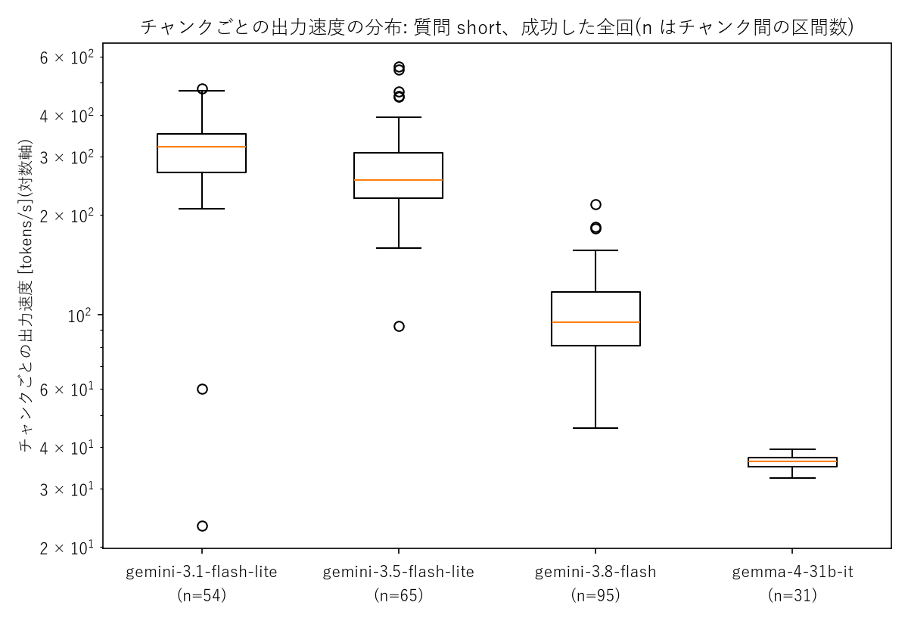

# 第1回 解答

## 演習

> ※ 基礎レベルの内容も含みます

- 講座に固有の質問(宿題の3レベル)へのモデルの回答(要約でよい):
  - `gemini-3.5-flash-lite` は「3レベル」を、基礎・入門/応用・実践/発展・挑戦という一般的な難易度の3段階であると答えた。「資料に具体的な定義があればそちらが優先」とは書いてあったが、講座の実際の内容は知らないまま、もっともらしく答えていた。
- 用語集の正しい意味と比べて気づいたこと:
  正しくは「基礎(講義内容の確認)／実装(自分でコードを書く)／発展(調査や試行)」で、どれか1つに取り組めば完了、原則として採点しない。加えて、課題は1つ取り組めば完了であるという事実も答えなかった。
- 表示できたトークン数(入力 / 出力):21 / 401

## 宿題

- 取り組んだレベル:**発展**
- やったこと:

### 実験条件

以下の4モデルについて3種類の質問を用意し、応答の内容や時間・速度の計測を行った。

| 項目 | 内容 |
|---|---|
| モデル | `gemini-3.5-flash-lite`, `gemini-3.1-flash-lite`, `gemini-3.8-flash`, `gemma-4-31b-it` |
| 質問 | `short`:「LoRAとは何ですか？」 |
| | `false_premise`:「秋田大学の学生に伝わっている、ヒグマに関するジンクスはなんですか？」 |
| | `long`: 「LoRAの仕組みについて解説する記事を、全体像から、低ランク分解の考え方など技術的側面を踏まえ、この手法のメリットやデメリット、実際の活用例について整理し、詳しく説明してください。聴衆は専門外の大学1年生が理解できる程度の言葉で読みやすい記事を心がけてください。」 |
| 呼び出し | `generate_content_stream` とし、temperatureなどはデフォルトの値を使用した |

> 補足
> 
> - `false_premise` はローカルな話題として選出した。実在するのはカモシカに関するジンクスであり、ヒグマに関するジンクスは特に伝わっていない
>   - ちなみに、正しくは「学内でカモシカに奇数回遭遇すると留年する」というジンクスが伝わっている
> - 無料枠を使用するレート制限を避けるために、質問ごとの間隔は `60 / RPM + 1` 秒以上空けた
> - どのモデルについても外部ツールの使用(Google検索によるグラウンディング)は無効とした

以下の値について計測を行った。

- `latency_s`
  - 送信から最後のチャンクを受信するまでの時間(思考(thinking)を含む)
- `ttft_s`
  - 送信から最初のチャンクを受信するまでの時間
- `output_s`
  - `latency_s - ttft_s` 出力開始からの所要時間
- `prompt_tokens` / `output_tokens` / `thinking_tokens`
  - APIの `usage_metadata` の値をそのまま取得
- `chunks`
  - 回答テキストを含むチャンクごとの `[受信時刻, 文字数, 累積出力トークン数]` の組

これを元に、リクエストごとの出力速度を `output_tokens / output_s` で求めた。

### 結果

#### 応答時間とトークン数

| モデル | 質問 | 試行回数 | 総時間(秒) | TTFT(秒) | 出力トークン数 | 思考トークン数 |
|---|---|---|---|---|---|---|
| `gemini-3.5-flash-lite` | `short` | 3 | 2.7 | 0.6 | 543 | 0 |
| | `false_premise` | 3 | 4.0 | 0.5 | 750 | 0 |
| | `long` | 8 | 7.0 | 0.7 | 1652 | 0 |
| `gemini-3.1-flash-lite` | `short` | 2 | 7.5 | 5.2 | 670 | 0 |
| | `false_premise` | 3 | 6.1 | 4.2 | 497 | 0 |
| | `long` | 8 | 5.2 | 0.9 | 1064 | 0 |
| `gemini-3.8-flash` | `short` | 3 | 39.6 | 31.3 | 824 | 998 |
| | `false_premise` | 2 | 26.8 | 24.9 | 204 | 1333 |
| | `long` | 3 | 145.6 | 124.4 | 2063 | 1259 |
| `gemma-4-31b-it` | `short` | 1 | 105.5 | 85.1 | 751 | 601 |
| | `false_premise` | 3 | 51.2 | 38.9 | 405 | 685 |
| | `long` | 4 | 88.9 | 46.6 | 1512 | 723 |

#### `false_premise` への回答傾向

- `gemini-3.5-flash-lite`
  - すべての回で「秋田県にヒグマはいない」と断りつつ、そのまま存在しないジンクスや学内の逸話を複数答えた
  - [秋田県によれば](https://www.pref.akita.lg.jp/pages/archive/85123)、ヒグマが秋田県には生息しないという話は正しいが、少なくともヒグマに関するジンクスや逸話については事実を確認できなかった
- `gemini-3.8-flash`
  - すべての回で「学内のヒグマの剥製に乗ると留年する」という存在しない話を答えた
  - 正しくは「学内でカモシカに奇数回遭遇すると留年する」ジンクスである
- `gemini-3.1-flash-lite`
  - すべての回で「存在しない」と答え、秋田県にはヒグマがいないこと、ツキノワグマとの混同、北海道の大学との混同を理由に挙げた
- `gemma-4-31b-it`
  - すべての回で「一般には知られていない」と答え、文脈を聞き返す提案をした

`gemini-3.1-flash-lite` と `gemma-4-31b-it` は、ジンクスに対して正しく答えた。一方、`gemini-3.8-flash` と `gemini-3.5-flash-lite` の出力は一部が事実と異なる事象が観察された。

#### レート制限との関係

無料枠のリクエスト回数には、[Google AI Studio のドキュメント](https://aistudio.google.com/docs/rate-limits)に記載されるとおり制限がある。今回使用したモデルの制限を以下に示す。

| モデル | RPM | TPM | RPD |
|---|---|---|---|
| `gemini-3.5-flash-lite` | 15 | 250K | 500 |
| `gemini-3.1-flash-lite` | 15 | 250K | 500 |
| `gemini-3.8-flash` | 5 | 250K | 20 |
| `gemma-4-31b-it` | 30 | 16K | 14.4K |

これを元に、特定の質問を RPM を超えない頻度で逐次的に行った場合に RPD の上限に到達するまでの時間を計算した。1質問あたりの時間は、ある質問の応答にかかった時間の中央値を使用した。

| モデル | 質問 | 1質問あたりの時間(秒) | 質問数/分 | RPM | RPD の上限に到達するまで |
|---|---|---|---|---|---|
| `gemini-3.5-flash-lite` | `short` | 2.7 | 約22 | 15 | 約33分 |
| | `false_premise` | 4.0 | 約15 | 15 | 約33分 |
| | `long` | 7.0 | 約9 | 15 | 約58分 |
| `gemini-3.1-flash-lite` | `short` | 7.5 | 約8 | 15 | 約63分 |
| | `false_premise` | 6.1 | 約10 | 15 | 約51分 |
| | `long` | 5.2 | 約12 | 15 | 約43分 |
| `gemini-3.8-flash` | `short` | 39.6 | 約1.5 | 5 | 約13分 |
| | `false_premise` | 26.8 | 約2.2 | 5 | 約9分 |
| | `long` | 145.6 | 約0.4 | 5 | 約49分 |
| `gemma-4-31b-it` | `short` | 105.5 | 約0.6 | 30 | 到達しない(1日約820回) |
| | `false_premise` | 51.2 | 約1.2 | 30 | 到達しない(1日約1,690回) |
| | `long` | 88.9 | 約0.7 | 30 | 到達しない(1日約970回) |

質問数/分が RPM を上回るのは、`gemini-3.5-flash-lite` に `short` の質問を行う場合のみであった。また `gemma-4-31b-it` は RPD が大きく、この条件では1日で上限に到達しないことがわかった。

### 気づき・疑問

#### 出力速度のブレ

出力開始から完了までの推移を以下の図に示す。青色の棒グラフは各チャンクのトークン数(左軸)と受信時刻を表す。赤色の折れ線グラフは累積出力トークン数(右軸)を表す。右軸の上端は総出力トークン数にあたり、上端に達した時点が出力完了に対応する。

- `short` の出力タイミングとトークン数の関係

- `long` の出力タイミングとトークン数の関係

続いて、2チャンク間のトークン数の増分を時間間隔で割って求めたチャンクごとの出力速度の分布(tok/s)を以下の図に示す。最初のチャンクは直前の区間がないため集計から除いた。また、時間間隔が0.01秒未満で短すぎる区間も除いた。

- `short` の出力速度の分布

- `long` の出力速度の分布

`long` の出力速度の分布を次の表に示す。

| モデル | 最小値(tok/s) | 中央値(tok/s) | 最大値(tok/s) |
|---|---|---|---|
| `gemini-3.1-flash-lite` | 79 | 318 | 617 |
| `gemini-3.5-flash-lite` | 20 | 263 | 569 |
| `gemini-3.8-flash` | 47 | 97 | 510 |
| `gemma-4-31b-it` | 29 | 36 | 41 |

`gemma-4-31b-it` では、1チャンク24トークンがほぼ等間隔で受信された。一方、gemini 系の3モデルは、`gemma-4-31b-it` に比べてブレが大きかった。

`gemini-3.8-flash` に `long` の質問を行った際の TTFT が65〜125秒であったのに対し、出力開始から完了までの時間は約21秒だった。出力開始後の速度が約100 tok/s で高速であるにもかかわらず、体感としては出力開始までに長時間待たされることがわかった。

#### 疑問

`gemini-3.8-flash` で1回だけ、先頭のチャンクが連続して短時間で受信される事象が観察された。具体的には、総出力79チャンクのうち73チャンクが最初のチャンクから0.06秒以内に受信された。同じ質問で3回のリクエストを試みたが事象が再現しなかったため、今回の集計からは除外したが、その原因は明らかでない。
