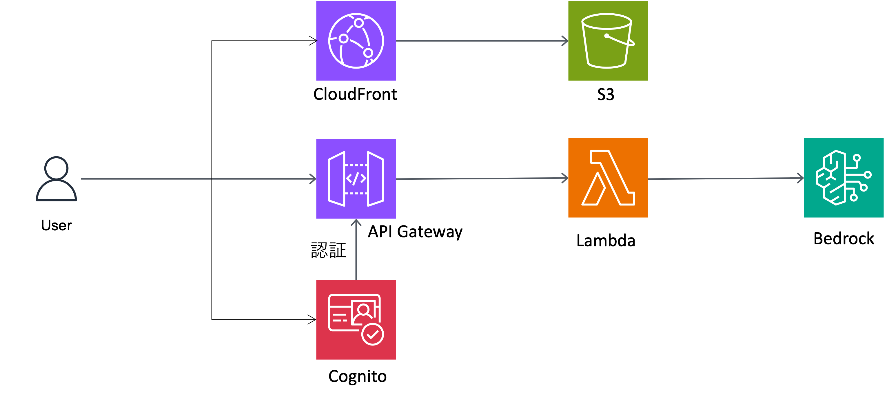

# 第7回 演習・宿題：チャットアプリを AWS にデプロイする

## この回のゴール

Amazon Bedrock を使うチャットアプリを、Terraform で自分の AWS アカウントにデプロイします。できるようになることは 3 つです。

- 変更計画（plan）を読み、実行先・作られるリソース・権限を確かめてから適用（apply）できる
- 公開 URL で、認証・回答・ログを確かめ、月額費用を試算できる
- 1 か所を変更して差分を読み、再デプロイと片付けまでを自分で行える

演習は、自分の fork の GitHub Codespaces で行います。AWS は、運営が配布する自分用のアカウントを使い、`aws sso login` でログインします。演習では Gemini API を使いません（LLM は Amazon Bedrock を使います）。宿題の発展1では、第1回から使っている Gemini API に接続先を変えられます。

## 演習で作るアプリ

[simplechat/](../../simplechat/) は、ログインした利用者だけが使えるチャットアプリです。役割ごとに、AWS のサービスを使います。



| 役割 | AWS のサービス | 定義している Terraform のファイル |
|---|---|---|
| 画面の配信（CDN） | Amazon CloudFront | `simplechat/terraform/frontend_hosting.tf` |
| 画面ファイルの保存 | Amazon S3 | `simplechat/terraform/frontend_hosting.tf`、`frontend_upload.tf` |
| 利用者の認証 | Amazon Cognito | `simplechat/terraform/cognito.tf` |
| API の入口 | Amazon API Gateway | `simplechat/terraform/api_gateway.tf` |
| アプリの処理 | AWS Lambda（Python） | `simplechat/terraform/lambda.tf`、`simplechat/lambda/index.py` |
| 回答の生成 | Amazon Bedrock（Amazon Nova Lite） | `simplechat/terraform/lambda.tf`（呼び出す権限とモデル ID） |
| ログ | Amazon CloudWatch Logs | `simplechat/terraform/lambda.tf` |

このほかに、Terraform の state（作ったリソースと実物の対応の記録）を保存する S3 バケットを 1 つ作ります。

## 第7回で使うファイル

演習で書き換えるファイルは、設定ファイルの 1 つです。ほかは、実行するか、読むだけです。

| ファイル | 何をするファイルか | 第7回ですること |
|---|---|---|
| [simplechat/terraform/](../../simplechat/terraform/) | AWS のリソースを定義した Terraform のファイルです | 読むだけです（宿題の実装で変更することがあります） |
| `simplechat/terraform/terraform.tfvars` | リージョン・モデル ID などの設定値です。[terraform.tfvars.example](../../simplechat/terraform/terraform.tfvars.example) をコピーして作ります | STEP 3 で作り、自分のアカウント ID とメールアドレスを書きます |
| [simplechat/scripts/setup-state-bucket.sh](../../simplechat/scripts/setup-state-bucket.sh) | state を保存する S3 バケットを作り、`terraform/backend.hcl` を作るスクリプトです | STEP 2 で実行します |
| [simplechat/scripts/delete-state-bucket.sh](../../simplechat/scripts/delete-state-bucket.sh) | state を保存した S3 バケットを削除するスクリプトです | 片付けで実行します |
| [simplechat/lambda/index.py](../../simplechat/lambda/index.py) | Bedrock を呼び出して回答を返す、API の処理です | 読むだけです（宿題の実装・発展で変更します） |
| [simplechat/frontend/](../../simplechat/frontend/) | チャットの画面（React。Vite でビルド）です | STEP 2 でビルドします |
| [simplechat/README.md](../../simplechat/README.md) | アプリの説明、コマンドの一覧、詳しいトラブルシューティングです | 困ったときに読みます |

## 料金と片付けについて

- AWS のリソースは、作っている間は料金がかかります。**Codespaces を停止・削除しても、AWS のリソースと料金は止まりません。**
- 宿題まで `answer.md` を書き終え、提出して、もう AWS を使わないと決めたときに [片付け](#片付け) をします。片付けるまでは、リソースの料金がかかり続けます。
- 宿題の期限を過ぎても発展を続けたい場合は、片付けを後に回してかまいません。`answer.md` の「片付け」欄に、片付ける予定の時期を書いて提出します。
- state は S3 に保存するので、Codespace を作り直しても、あとから片付けられます（[Codespace を作り直したとき](#codespace-を作り直したとき)）。

## 演習（30分）

準備から STEP 6 までを、約 26 分で行います。準備は、講義の前に済ませておくと、演習の時間に余裕ができます。

### 準備：lec07 ブランチを作り、Codespace の環境を更新する（約5分）

第7回の更新を自分の fork に取り込み、作業用の `lec07` ブランチを作ります。第7回では Terraform と AWS CLI を使うので、Codespace の環境（`.devcontainer/`）も更新します。

1. 自分の fork のページで **Sync fork → Update branch** を押します（すでに最新の場合は、押すものはありません）
2. Codespaces のターミナルで、次のコマンドを上から順に実行します

```bash
git switch main
git pull --no-rebase
git switch -c lec07
```

3. 画面上部の検索欄に `>Codespaces: Rebuild Container` と入力して実行し、「Rebuild」を押します。数分かかります（ファイルは消えません）
4. 再接続したら、ターミナルで次のコマンドを実行し、バージョンが表示されることを確認します

```bash
git branch --show-current
terraform version
aws --version
node --version
```

- 1 行目に `lec07` と表示されます。`main` と表示されたら、`git switch lec07` で切り替えます
- `terraform: command not found` と出るときは、手順 3 の Rebuild がまだです。新しく Codespace を作り直してもかまいません
- `git switch main` で止まるときは、前の回のブランチに変更が残っています。commit してから、もう一度実行します
- `a branch named 'lec07' already exists` と出るときは、`git switch lec07` で切り替えます
- `git pull --no-rebase` で `CONFLICT` と出るときは、`git merge --abort` で元に戻し、下の手順で始めます（自分の変更は消えません）

#### 前の回までの作業が終わっていない場合

第7回の開始時点（`lec07-start` タグ）から始めます。次のコマンドを上から順に実行し、そのあと手順 3 の Rebuild を行います。

```bash
git fetch https://github.com/matsuolab/lecture-ai-engineering-2026.git tag lec07-start
git switch -c lec07 lec07-start
```

Sync fork で衝突の表示が出た場合も、こちらで始めます。「Discard commits」は押しません（自分のコミットが消えます）。

### STEP 1：AWS にログインし、実行先を確かめる（約3分）

ゴール：自分用の AWS アカウントにログインし、どのアカウント・ロールで操作するかを確かめる

1. 初回だけ、ログイン用のプロファイル `lecture-practical-ai-engineering` を作ります。Codespaces ではブラウザが自動で開かないため、`--use-device-code` を付けます

```bash
aws configure sso --use-device-code
```

聞かれる順に、次の値を入力します。

| 表示される質問 | 入力する値 |
|---|---|
| `SSO session name (Recommended):` | `aie-sso` |
| `SSO start URL [None]:` | `https://d-9567b5c296.awsapps.com/start` |
| `SSO region [None]:` | `ap-northeast-1` |
| `SSO registration scopes [sso:account:access]:` | 何も入力せずに Enter |
| （URL とコードが表示されます。手順 2 で許可すると、続きの質問に進みます） | |
| `Default client Region [None]:` | `us-east-1` |
| `CLI default output format (json if not specified) [None]:` | `json` |
| `Profile name [Student-…]:` | `lecture-practical-ai-engineering` |

- アカウントとロールは 1 つずつなので、自動で選ばれます（`Using the account ID …`、`Using the role name "Student"` と表示されます）
- `SSO region` はログインの窓口があるリージョン（東京）、`Default client Region` はアプリを作るリージョン（バージニア北部）です。違う値で正しいです

2. 表示された URL（`https://d-9567b5c296.awsapps.com/start/#/device`）をブラウザで開き、表示されたコードを入力して許可します。2 回目以降、またはログインの期限が切れたときは、次のコマンドでログインし直します

```bash
aws sso login --use-device-code --profile lecture-practical-ai-engineering
```

3. 以降のコマンドがこのプロファイルを使うように設定し、実行先を確かめます

```bash
export AWS_PROFILE=lecture-practical-ai-engineering
aws sts get-caller-identity
```

4. `Account` が配布されたアカウント ID と一致すること、`Arn` にロール名 `AWSReservedSSO_Student_` が含まれることを確認します
5. Bedrock のモデルを呼び出せることを確認します。回答の文章が 1 行表示されれば、使えます

```bash
aws bedrock-runtime converse \
  --model-id us.amazon.nova-lite-v1:0 \
  --messages '[{"role":"user","content":[{"text":"Hello"}]}]' \
  --query 'output.message.content[0].text' --output text
```

- `Arn` の末尾には、ログインした人のメールアドレスが含まれます。`aws sts get-caller-identity` の結果は、`answer.md` やチャットに貼らないでください
- `export AWS_PROFILE=...` は、ターミナルを開き直すと消えます。新しいターミナルでは、もう一度実行します

### STEP 2：state の保存先を作り、画面をビルドする（約3分）

ゴール：state を保存する S3 バケットと、S3 にアップロードする画面ファイルを用意する

1. リポジトリ直下で、state 用の S3 バケットを作るスクリプトを実行します

```bash
./simplechat/scripts/setup-state-bucket.sh
```

2. 表示されたアカウント ID が、STEP 1 と同じであることを確認します。最後に、`terraform/backend.hcl` の内容が表示されます
3. 画面（React）をビルドします。`simplechat/frontend/build/` ができます

```bash
cd simplechat/frontend
npm ci
npm run build
cd ../terraform
```

- スクリプトは、`simplechat-tfstate-<アカウントID>-<リージョン>` という名前のバケットを作り、一般公開の禁止・バージョニング（過去の版を残す）・暗号化を設定します。すでにある場合は作り直しません
- state を Codespace の中ではなく S3 に置くのは、Codespace を削除しても state が消えないようにするためです。state がなくなると、作ったリソースを Terraform で管理・削除できなくなります
- `backend.hcl` にはアカウント ID が含まれます。`.gitignore` で、Git に入らないようにしてあります

### STEP 3：変更計画（plan）を読む（約3分）

ゴール：適用する前に、何がどこに作られるかを plan で確かめる

1. `simplechat/terraform` で、設定値のファイルを作ります

```bash
cp terraform.tfvars.example terraform.tfvars
```

2. `terraform.tfvars` を開き、次の 2 か所を書き換えます
   - `allowed_account_ids` の行の先頭の `# ` を消して、STEP 1 で確かめた自分のアカウント ID を書きます。別のアカウントで実行すると、Terraform がエラーで止まるようになります
   - `allowed_emails` の `you@example.com` を、自分のメールアドレスに書き換えます。画面にログインできるのは、ここに書いたアドレスだけです（画面からのサインアップはできないようにしてあります）

```hcl
allowed_account_ids = ["123456789012"]
allowed_emails      = ["your-name@example.ac.jp"]
```

3. 初期化して、書式と構文を確かめてから、変更計画を作ります

```bash
terraform init -backend-config=backend.hcl
terraform fmt -check
terraform validate
terraform plan -out=day7.tfplan
```

4. plan の表示で、次の 3 つを確かめます
   - 最後の行が `Plan: 36 to add, 0 to change, 0 to destroy.` で、**作成（add）だけ** であること（`allowed_emails` にアドレスを 1 つ書いた場合。1 つ増やすごとに 1 増えます）
   - `aws_cloudfront_distribution`、`aws_cognito_user_pool`、`aws_cognito_user`（`allowed_emails` のユーザー）、`aws_lambda_function` などが作られること
   - `aws_iam_role_policy.chat_lambda_bedrock` で、Lambda に許可される操作が `bedrock:InvokeModel` と `bedrock:InvokeModelWithResponseStream` であること
5. plan の表示から、`# aws_lambda_function.chat will be created` の行を探し、そこから対応する `}` までを `answer.md` に貼り付けます。関数名・実行環境（`runtime`）・環境変数（`MODEL_ID`）・タイムアウトなど、作られる Lambda の設定を目で確かめます

- `terraform init` は、provider（AWS を操作する部品）をダウンロードし、state の保存先として STEP 2 のバケットを設定します。provider の版は `.terraform.lock.hcl` で固定しています
- `terraform fmt -check` は、何も表示されなければ問題ありません
- plan の表示が流れて見えなくなったときは、`terraform show day7.tfplan` で、保存した計画をもう一度表示できます
- 想定外の削除（destroy）や置き換え（replace）、広すぎる権限、別のアカウントが表示されたら、その場で止めて確認します
- `allowed_emails` を例のまま（`@example.com`）にしていると、plan がエラーで止まります
- plan の表示の `aws_cognito_user` の部分には、メールアドレスが出ます。`answer.md` に貼るのは、手順 5 の Lambda の部分だけにします

### STEP 4：適用（apply）して、公開 URL を得る（約5分）

ゴール：STEP 3 で読んだ計画を適用し、アプリの公開 URL を得る

```bash
terraform apply day7.tfplan
terraform output
```

1. `Apply complete! Resources: 36 added, 0 changed, 0 destroyed.` と表示されることを確認します。3〜5 分かかります（CloudFront の作成に時間がかかります）。途中で、`allowed_emails` のアドレスに招待メールが届きます
2. `terraform output` で表示された `cloudfront_url` が、アプリの公開 URL です
3. `answer.md` には、apply の最後の行と `cloudfront_distribution_id` を書きます。`cloudfront_url` は書きません。ログインできるのは `allowed_emails` のアドレスだけですが、画面の URL は人に教えないでおきます

`terraform output` の表示（値は人によって違います）：

```text
api_gateway_url = "https://xxxxxxxxxx.execute-api.us-east-1.amazonaws.com/prod/"
aws_account_id = "123456789012"
aws_region = "us-east-1"
chat_api_endpoint = "https://xxxxxxxxxx.execute-api.us-east-1.amazonaws.com/prod/chat"
chat_lambda_function_name = "simplechat-chat"
cloudfront_distribution_id = "EXXXXXXXXXXXXX"
cloudfront_url = "https://dxxxxxxxxxxxxx.cloudfront.net"
model_id = "us.amazon.nova-lite-v1:0"
user_pool_client_id = "xxxxxxxxxxxxxxxxxxxxxxxxxx"
user_pool_id = "us-east-1_xxxxxxxxx"
website_bucket_name = "simplechat-web-xxxxxxxxxxxxxxxxxxxxxxxxxx"
```

`apply` に保存した計画（`day7.tfplan`）を渡すと、STEP 3 で読んだ内容だけが適用されます。計画を作ったあとに state が変わっていた場合は、`Saved plan is stale` と出て止まります。

### STEP 5：公開 URL で動作を確かめる（約5分）

ゴール：ログインから回答までを通し、ログイン前のアクセスとログも確かめる

1. `cloudfront_url` をブラウザで開きます
2. `allowed_emails` のアドレスに届いた、件名が `simplechat: temporary password` のメールを開き、仮パスワード（`temporary password is` のあとの文字列）を確かめます
3. 画面の `Email` の欄にメールアドレスを、`Password` の欄に仮パスワードを入力して、**Sign in** を選びます
4. 新しいパスワードを決める画面が出るので、`Password` と `Confirm Password` の欄に新しいパスワードを入力します。パスワードは 8 文字以上で、英大文字・英小文字・数字を含めます
5. 短い質問を送り、回答が返ることを確認します
6. ターミナルで、ログインせずに API を呼ぶと、401（認証エラー）が返ることを確認します

```bash
curl -i -X POST "$(terraform output -raw chat_api_endpoint)" \
  -H 'Content-Type: application/json' \
  -d '{"message":"hello","conversationHistory":[]}'
```

7. 直近 10 分の Lambda のログから、手順 5 の質問の記録を表示し、`answer.md` に貼り付けます。次のコマンドは、使ったモデル（`Using model:`）・Bedrock の応答（`Bedrock response:`）・実行時間（`REPORT`）の行だけを表示します

```bash
aws logs tail "/aws/lambda/$(terraform output -raw chat_lambda_function_name)" --since 10m \
  --filter-pattern '?"Using model" ?"Bedrock response" ?REPORT'
```

- `Bedrock response:` の行の `usage` に、その 1 回の入力・出力のトークン数が出ます（宿題の基礎の月額試算で使います）。`REPORT` の行には、Lambda の実行時間とメモリの使用量が出ます
- Lambda は、ログインのトークンやメールアドレスをログに書かないようにしてあります。それでも `answer.md` には、上のコマンドで表示した行だけを貼ります
- 401 の応答は、API Gateway が Cognito のトークンを確かめて返しています。Lambda は呼ばれないので、ログにも出ません
- 招待メールが届かないときは、迷惑メールのフォルダを確認します。仮パスワードの期限は 7 日です。期限が切れたときや、メールをなくしたときは、[うまくいかないとき](#うまくいかないとき) の手順で送り直します
- 画面には **Create Account** のタブがありません。`allowed_emails` にないアドレスでは、サインアップもログインもできません

### STEP 6：記録して提出する（約2分）

ゴール：結果を `answer.md` に書いて PR を出す

1. `lectures/07/answer.md` を開き、「演習」欄に、STEP 3〜5 で確かめた plan・apply・`curl`・ログの結果を貼り付けます
2. `git status` で、変更したファイルが `lectures/07/answer.md` だけであることを確認します。`terraform.tfvars` や `backend.hcl` は、`.gitignore` で Git に入らないようにしてあります
3. commit と push をします

```bash
cd ../..
git status
git add lectures/07/answer.md
git commit -m "第7回 演習"
git push -u origin lec07
```

4. GitHub で、`lec07` から自分の fork の `main` への PR を作ります。base repository が自分の fork になっていることを確認します

STEP 5 まで終わらなかった場合は、終わったところまでを書いて提出し、続きは同じブランチに push します。演習が終わったら、AWS のリソースは残したまま、[宿題](#宿題どれか1つで完了) に進みます。

### 片付け

宿題まで `answer.md` を書き終え、提出して、もう AWS を使わないと決めたときに行います。片付けたあとは、作ったアプリと state は元に戻せません（続けたくなったときは、STEP 2 からやり直します）。片付けの結果も `answer.md` の「片付け」欄に書いて push します。

宿題の期限を過ぎても発展を続けたい場合は、片付けを後に回してかまいません。

- 提出するときは、`answer.md` の「片付け」欄で「後で行う」を選び、片付ける予定の時期を書きます
- 続けている間も、リソースの料金はかかります。画面の URL は公開しないでください
- 片付けたら、「片付け」欄を書き直して、同じブランチに push します

1. `simplechat/terraform` で、削除される対象を確かめてから、アプリのリソースを削除します。`yes` と入力すると削除が始まり、3〜10 分ほどかかります（CloudFront の削除に時間がかかります）

```bash
cd simplechat/terraform
terraform plan -destroy
terraform destroy
```

2. `Destroy complete! Resources: 36 destroyed.` と表示されたら、リポジトリ直下に戻り、state 用のバケットを削除します。確認のため、バケット名の入力を求められるので、表示されたバケット名を入力します

```bash
cd ../..
./simplechat/scripts/delete-state-bucket.sh
```

3. AWS マネジメントコンソールで、リソースが残っていないことを確認します（S3、CloudFront、Lambda、API Gateway、Cognito、CloudWatch Logs）
4. 画面左下の「Codespaces」を押し、「Stop Current Codespace」を選びます

- `delete-state-bucket.sh` は、state にリソースが残っているときは削除せずに終了します。先に手順 1 を済ませます
- state 用のバケットを削除すると、state は元に戻せません
- 削除される数は、STEP 4 で作った数と同じです（`allowed_emails` にアドレスを 1 つ書いた場合は 36）。宿題でリソースを追加した場合は、それより多くなります。発展1で Secrets Manager にシークレットを保存した場合は、それも削除します（[発展1の手順 4](#gemini-api-に接続する手順)）

### Codespace を作り直したとき

state は S3 にあるので、新しい Codespace からも作業を続けられます（片付けもできます）。リポジトリ直下で、次のコマンドを上から順に実行します。

```bash
aws sso login --use-device-code --profile lecture-practical-ai-engineering
export AWS_PROFILE=lecture-practical-ai-engineering
aws sts get-caller-identity
./simplechat/scripts/setup-state-bucket.sh
cd simplechat/frontend && npm ci && npm run build && cd ../terraform
cp terraform.tfvars.example terraform.tfvars
terraform init -backend-config=backend.hcl
terraform plan
```

- 初回の `aws sso login` の前に、STEP 1 の `aws configure sso --use-device-code` が必要です
- `terraform.tfvars` は Git に入れていないので、前回変えた値（`allowed_account_ids`、`allowed_emails`、`model_id` など）を書き直します
- 何も変えていなければ、`terraform plan` は `No changes.` になります

### うまくいかないとき

解決しないときは、チャットで、症状と表示されたメッセージを知らせてください。アカウント ID・トークン・パスワードは伏せます。

| 症状 | 対処 |
|---|---|
| `terraform: command not found` と出る | 準備の手順 3（Rebuild Container）を行います |
| `Error loading SSO Token`、`token has expired` と出る | ログインの期限切れです。`aws sso login --use-device-code --profile lecture-practical-ai-engineering` を実行します |
| `Unable to locate credentials` と出る | `export AWS_PROFILE=lecture-practical-ai-engineering` を実行していません。ターミナルを開き直した場合も、もう一度実行します |
| `AWS account ID not allowed` と出る | `allowed_account_ids` と違うアカウントで実行しています。`aws sts get-caller-identity` で確かめます |
| `Backend initialization required` と出る | `terraform init -backend-config=backend.hcl` を実行します。`backend.hcl` がないときは、先に STEP 2 のスクリプトを実行します |
| `frontend/build/index.html が見つかりません` と出る | STEP 2 の画面のビルドを行います |
| `Error acquiring the state lock` と出る | 別の terraform コマンドが実行中です。終わるのを待ってから、もう一度実行します |
| 招待メールが届かない、仮パスワードの期限（7 日）が切れた | 迷惑メールのフォルダを確かめます。送り直すときは、`simplechat/terraform` で `aws cognito-idp admin-create-user --user-pool-id "$(terraform output -raw user_pool_id)" --username <メールアドレス> --message-action RESEND` を実行します |
| 画面で `Incorrect username or password.` と出る | パスワードのほかに、`allowed_emails` に書いたアドレスと、入力したアドレスが同じかも確かめます（登録されていないアドレスでも、同じメッセージが出ます）。`allowed_emails` を変えたときは、plan と apply をやり直します |
| URL を開くと画面は出るが、質問すると 500 になる | 画面には詳しい理由を返さないので、STEP 5 の手順 7 で Lambda のログ（`Error:` の行）を見ます。`AccessDeniedException` なら、Bedrock の権限かモデル ID を確かめます |
| plan に想定外の削除（destroy）や置き換え（replace）がある | 適用せずに止めます。何を変えたか（`git diff`）と、どのリソースが影響を受けるかを確かめます |

API Gateway・Lambda を単体でテストする方法は、[simplechat/README.md](../../simplechat/README.md) の「トラブルシューティング」を見てください。

## 宿題（どれか1つで完了）

基礎・実装・発展1・発展2 の 4 つから 1 つを選びます。どれか 1 つに取り組めば完了です。

| レベル | 内容 | 記録すること |
|---|---|---|
| 基礎 | 初回デプロイを完了し、動作を確かめます | 動作・公開範囲・構成・月額試算 |
| 実装 | 設定かコードを 1 か所変更し、差分を読んで再デプロイします | 変更理由・差分・結果・戻し方 |
| 発展1 | LLM の接続先を、Bedrock 以外の API に変えます | API の仕様・観測した失敗・修正の根拠 |
| 発展2 | Lambda を新旧 2 つの版で動かし、一部だけ新しい版に流して確かめてから切り替え、切り戻します。続けて、同じ作業を AI に行わせ、人は報告を読んで承認します | 各段階の plan の差分・振り分けの結果・判断の基準・切り戻しにかかった時間・AI の報告と承認の記録 |

どのレベルも、`answer.md` を書き終えて提出し、もう AWS を使わないと決めたら [片付け](#片付け) をします。期限を過ぎても発展を続けたい場合は、片付ける予定の時期を書いて提出すれば、片付けは後に回してかまいません。

### 基礎の進め方

演習の STEP 5 までを終え、次の 4 つを `answer.md` に記録します。

| 記録すること | 書く内容 |
|---|---|
| 動作 | ログで確かめたこと（時刻、使ったモデル、トークン数、実行時間） |
| 公開範囲 | 画面の URL・API・サインアップを、誰が使えるか。ログインしないと何ができないか |
| 構成 | 「演習で作るアプリ」の表の役割が、どのリソースにあたるか（`terraform state list` で一覧を表示できます） |
| 月額試算 | 下の手順で計算した、推論の月額と、その前提 |

月額試算は、利用量を仮定して積み上げます。

1. 1 か月の質問数を仮定します（例：利用者 100 人 × 1 日 10 回 × 20 日 = 20,000 回）
2. 1 回あたりの入力・出力のトークン数を、STEP 5 のログの `usage` で確かめます（会話を続けると、それまでの会話も入力に含まれます）
3. 使ったモデル（`terraform output model_id`）の入力・出力の単価を、[Amazon Bedrock の料金ページ](https://aws.amazon.com/bedrock/pricing/) で調べます
4. 推論の月額 = 質問数 ×（入力トークン数 × 入力単価 ＋ 出力トークン数 × 出力単価）で計算します

Lambda・API Gateway・CloudFront・S3・CloudWatch Logs にも、利用量に応じた料金がかかります。無料利用枠を引く前の金額で計算し、無料利用枠の条件は別に確かめます。

### 実装の進め方

1 か所だけ変更し、**plan で差分を読んでから** 再デプロイします。同じ質問を送り、変更の前後を比べます。

| 変更の例 | 変更するところ | plan で見える差分 |
|---|---|---|
| モデルを変える | `terraform.tfvars` の `model_id`（例：`us.amazon.nova-micro-v1:0`） | `aws_lambda_function.chat` の環境変数 `MODEL_ID` だけが更新（update in-place） |
| 生成の設定を変える | `simplechat/lambda/index.py` の `maxTokens`、`temperature` など | `aws_lambda_function.chat` の `source_code_hash` が更新 |
| 画面を変える | `simplechat/frontend/src/` の文言など（変更後に `npm run build`） | 新しい名前の画面ファイルの作成と、古い名前の画面ファイルの削除、`index.html` の更新 |

```bash
cd simplechat/terraform
terraform plan -out=day7.tfplan
terraform apply day7.tfplan
```

- 画面を変えると、ファイル名（`assets/index-<ハッシュ>.js`）がビルドごとに変わるので、S3 上の古い画面ファイルの削除（destroy）が plan に出ます。これは意図した変更です。`aws_s3_bucket` や `aws_cloudfront_distribution` の削除や置き換えが出たときは、適用せずに止めます
- モデルを変えるときは、利用の権限・API の形式・料金も確かめます。Nova 以外のモデルでは、`index.py` のリクエストの形式を変える必要がある場合があります
- 戻し方も記録します。変更を元に戻して、もう一度 plan と apply をします（`git diff` で変更点を確かめ、`git restore <ファイル>` で戻せます）

### 発展1の進め方：LLM の接続先を変える

`simplechat/lambda/index.py` の `bedrock_client.invoke_model(...)` が、LLM を呼び出している部分です。ここを書き換えて、接続先を変えます。

| 接続先 | 例 | 確かめること |
|---|---|---|
| A：外部の LLM API | **Gemini API（おすすめ）**、OpenAI API など | 認証の方法・料金・利用の制限 |
| B：手元の PC で動かす LLM | Ollama ＋ ngrok など | 外から接続するための認証、メモリ・速度、使い終わったら止めること |

Gemini API は、第1回から使っている API キー（Codespaces secret の `GEMINI_API_KEY`）と無料枠をそのまま使えるので、いちばん始めやすい接続先です。下の「Gemini API に接続する手順」で進めます。ほかの接続先でも、手順の流れは同じです。

1. 先に、`curl` などで最小の 1 リクエストを通し、送る内容と返る内容を確かめます
2. `index.py` を書き換え、再デプロイして、同じ質問で確かめます
3. うまくいかないときは、次の表で、どこが合っていないかを調べます

| 合わせること | 比べるもの | 失敗したときの手がかり |
|---|---|---|
| 接続 | URL・パス・HTTPS | 404、接続できない |
| 認証 | ヘッダー・キー・権限 | 401、403 |
| 入力 | model・messages などの JSON | 400、422 |
| 出力 | 本文・エラーの形式 | 解析のエラー、空の回答 |
| 利用の上限 | 1 分あたり・1 日あたりの回数 | 429 |
| 時間 | 待ち時間 | timeout（Lambda は既定 30 秒、API Gateway は 29 秒が上限） |

#### Gemini API に接続する手順

**1. Codespaces から最小の 1 リクエストを送る**

```bash
curl -s "https://generativelanguage.googleapis.com/v1beta/models/gemini-3.5-flash-lite:generateContent" \
  -H "x-goog-api-key: $GEMINI_API_KEY" \
  -H "Content-Type: application/json" \
  -d '{"contents":[{"role":"user","parts":[{"text":"桃太郎の話を3行で教えて"}]}]}'
```

回答は `candidates[0].content.parts[0].text`、トークン数は `usageMetadata` に入っています。

**2. Bedrock との違いを確かめる**

`index.py` で書き換えるのは、次の表の部分です。

| 項目 | Bedrock（Nova、今のコード） | Gemini API |
|---|---|---|
| 呼び出し先 | `bedrock_client.invoke_model(modelId=...)` | `POST https://generativelanguage.googleapis.com/v1beta/models/<モデル>:generateContent` |
| 認証 | Lambda の実行ロール（IAM） | ヘッダー `x-goog-api-key` |
| 会話の履歴 | `messages`。役割は `user`・`assistant` | `contents`。役割は `user`・`model` |
| 発言の本文 | `"content": [{"text": ...}]` | `"parts": [{"text": ...}]` |
| 生成の設定 | `inferenceConfig`（`maxTokens`・`temperature` など） | `generationConfig`（`maxOutputTokens`・`temperature` など） |
| 回答 | `output.message.content[0].text` | `candidates[0].content.parts[0].text` |
| トークン数 | `usage` | `usageMetadata` |

- 画面とやりとりする会話の履歴（`conversationHistory`）の役割は `assistant` のままにし、Gemini に送るときだけ `model` に変えます
- HTTP の呼び出しは、Python の標準ライブラリ `urllib.request` で書けます。Lambda には `index.py` だけをアップロードしているので、`google-genai` などのパッケージを使う場合は、パッケージも一緒にアップロードする必要があります
- モデル名は、今と同じ環境変数 `MODEL_ID` で渡せます（`terraform.tfvars` で `model_id = "gemini-3.5-flash-lite"`）

**3. API キーを Secrets Manager で渡す**

API キーは、Terraform を通さずに AWS CLI で AWS Secrets Manager に保存します。Terraform の変数や `aws_secretsmanager_secret_version` で渡すと、キーが state に平文で残るためです。

```bash
aws secretsmanager create-secret --name simplechat/gemini-api-key --secret-string "$GEMINI_API_KEY"
```

Terraform（`lambda.tf`）では、次の 3 つを追加します。

- `data "aws_secretsmanager_secret"` でシークレットを名前から探します（ARN などの情報だけを読み、キーの値は state に入りません）
- Lambda の実行ロールに、このシークレットだけを対象にした `secretsmanager:GetSecretValue` の権限を付けます
- Lambda の環境変数に、シークレットの ARN を渡します

`index.py` では、`boto3.client("secretsmanager").get_secret_value(SecretId=...)["SecretString"]` でキーを読み出します。毎回読まないように、`bedrock_client` と同じようにグローバル変数に入れておきます。

plan では、IAM ポリシーの追加と `aws_lambda_function.chat` の更新（`source_code_hash`・環境変数）が出ることを確かめてから適用します。Bedrock を使わなくなった場合は、Bedrock の権限を外すこともできます。

**4. 片付けでシークレットも削除する**

シークレットは Terraform の管理外なので、`terraform destroy` では消えません。[片付け](#片付け) のあとに削除します（保存している間、1 件あたり月 0.40 ドルの料金がかかります）。

```bash
aws secretsmanager delete-secret --secret-id simplechat/gemini-api-key --force-delete-without-recovery
```

#### 発展1の注意

- **API キーをコードや Git に書かないでください。** Lambda の環境変数を Terraform の変数で渡すと、`sensitive = true` を付けても state には平文で残ります
- 画面にログインできるのは、`allowed_emails` のアドレスだけです。ほかの人のアドレスを加えると、その人の利用でも、あなたの API キーの無料枠が減ります。終わったら片付けます
- 外部の API に送った質問は、その提供者に送られます。Gemini API の無料枠では、送った内容が Google のサービスの改善に使われることがあるので、個人情報や秘密の情報は送らないでください
- Lambda から呼んだ場合も、無料枠のレート制限（429）は同じようにかかります。観測した失敗として記録してかまいません

### 発展2の進め方：Blue/Green で切り替え、切り戻す

**Blue/Green** は、今の版（Blue）を動かしたまま新しい版（Green）を用意し、確かめてから切り替える方法です。一部の利用だけを Green に流して様子を見ることを **カナリア**、問題があったときに Blue に戻すことを **切り戻し** と呼びます。Lambda では、次の 2 つを使います。

| 仕組み | 内容 |
|---|---|
| バージョン | コードと設定（環境変数を含む）を固定して残したもの。`1`、`2`、`3` と番号が付き、作ったあとは変わりません |
| エイリアス | どのバージョンに流すかを指す名前（ここでは `live`）。2 つのバージョンに、割合で振り分けることもできます |

API Gateway が関数ではなくエイリアス `live` を呼ぶようにすると、エイリアスの指す先を変えるだけで、画面や API に触らずに切り替え・切り戻しができます。

```text
画面 → API Gateway → エイリアス live ─┬→ バージョン 1（Blue） 90%
                                      └→ バージョン 2（Green）10%
```

発展2 は、2 段階で進めます。**2-1 を自分で終えてから**、2-2 で同じ作業を AI に行わせます。

#### 2-1：自分で切り替え・切り戻しをする

**1. エイリアスを経由する構成にする**

`simplechat/terraform` で、次の 4 か所を変更します。

| ファイル | 変更 |
|---|---|
| `lambda.tf` | `aws_lambda_function.chat` に `publish = true` を加えます。変更のたびに新しいバージョンが作られます |
| `lambda_alias.tf`（新規） | 下のエイリアスを作ります |
| `variables.tf`・`outputs.tf` | 下の変数と出力を加えます |
| `api_gateway.tf` | `aws_api_gateway_integration.chat_post` の `uri` を `aws_lambda_alias.live.invoke_arn` に変え、`aws_lambda_permission.api_gateway` に `qualifier = aws_lambda_alias.live.name` を加えます |

`lambda_alias.tf`：

```hcl
resource "aws_lambda_alias" "live" {
  name             = "live"
  function_name    = aws_lambda_function.chat.function_name
  function_version = coalesce(var.stable_version, aws_lambda_function.chat.version)

  # canary_weight が 0 より大きいときだけ、最新のバージョンに振り分ける
  dynamic "routing_config" {
    for_each = var.canary_weight > 0 ? [1] : []
    content {
      additional_version_weights = {
        (aws_lambda_function.chat.version) = var.canary_weight
      }
    }
  }

  lifecycle {
    precondition {
      condition     = var.canary_weight == 0 || (var.stable_version != null && var.stable_version != aws_lambda_function.chat.version)
      error_message = "canary_weight を 0 より大きくするときは、stable_version に最新より前のバージョンを指定してください。"
    }
  }
}
```

`variables.tf` と `outputs.tf` に加えるもの：

```hcl
variable "stable_version" {
  description = "エイリアス live が主に指すバージョン（Blue）。null のときは最新のバージョン"
  type        = string
  default     = null
}

variable "canary_weight" {
  description = "最新のバージョン（Green）に振り分ける割合（0 以上 1 未満）"
  type        = number
  default     = 0

  validation {
    condition     = var.canary_weight >= 0 && var.canary_weight < 1
    error_message = "canary_weight は 0 以上 1 未満にしてください。"
  }
}

output "chat_lambda_latest_version" {
  value = aws_lambda_function.chat.version
}
```

plan が `Plan: 3 to add, 3 to change, 2 to destroy.` になることを確かめてから適用します。エイリアスの作成、API Gateway の呼び出し先と許可の付け替え（許可とデプロイは置き換え）、Lambda の `publish` の変更が出ます。適用すると、最初のバージョンができます。番号を `terraform output chat_lambda_latest_version` で確かめます。画面から質問し、今までどおり回答が返ることも確かめます。

- 最初のバージョンの番号は、多くの場合 `1` です。同じアカウントで関数を作り直した場合（片付けてからやり直した場合など）は、`3` などから始まることがあります。以下は `1` から始まったものとして説明するので、違うときは、確かめた番号に読み替えます
- 適用の直後は、1〜2 分のあいだ、質問すると 500（`Internal server error`）が返ることがあります。API Gateway から Lambda を呼ぶ許可を置き換えたことが、反映されるまで時間がかかるためです。少し待ってから、もう一度試します

**2. 判断の基準を先に決める**

Green を出す前に、切り替えるか切り戻すかの基準を決めて `answer.md` に書きます（例：エラーが 0 件、応答時間が Blue の 2 倍を超えない、回答が質問に沿っている）。Green の件数が少ないときにどうするか（例：3 件未満なら呼び出しを追加する）も決めておきます。

**3. Green を作り、10% だけ流す**

`terraform.tfvars` で、すでにある `model_id` の行を書き換え、`stable_version` と `canary_weight` の 2 行を加えます（`allowed_account_ids` の行は残します）。Green の変更は 1 か所だけにします（ここでは、モデルを変えます。`index.py` の `maxTokens` などでもかまいません）。

```hcl
model_id       = "us.amazon.nova-micro-v1:0" # すでにある行を書き換える
stable_version = "1"                         # 手順 1 で確かめた番号
canary_weight  = 0.1
```

`model_id` の行を書き換えずに加えると、同じ設定が 2 つになり、plan が `Attribute redefined` のエラーで止まります。

plan が `Plan: 0 to add, 2 to change, 0 to destroy.`（Lambda の環境変数と新しいバージョン、エイリアスの `routing_config`）になることを確かめてから適用します。

**4. カナリアの状況を確かめる**

エイリアス `live` を 30 回呼び、どのバージョンが答えたかを数えます。`ExecutedVersion` が、実際に動いたバージョンです。

```bash
FN=$(terraform output -raw chat_lambda_function_name)
for i in $(seq 1 30); do
  aws lambda invoke --function-name "${FN}:live" \
    --cli-binary-format raw-in-base64-out \
    --payload '{"body":"{\"message\":\"Hello\",\"conversationHistory\":[]}"}' \
    --query ExecutedVersion --output text /dev/null
done | sort | uniq -c
```

続けて、ログでバージョンごとの違いを確かめます。ログの各行の 2 列目（ログストリーム名）の `[1]`・`[2]` が、バージョンです。

```bash
aws logs tail "/aws/lambda/${FN}" --since 10m \
  --filter-pattern '?"Using model" ?"Bedrock response" ?REPORT ?Error'
```

- 割合はおおよそです（10% で 30 回なら、Green は 1〜6 回程度）。Green が少なくて判断できないときは、もう一度 30 回呼びます
- `Using model:` の行で、バージョンごとに使ったモデルが違うことが分かります。`REPORT` の行の `Duration` で、応答時間を比べます
- 各バージョンの最初の呼び出しは、起動の時間（`REPORT` の行の `Init Duration`）が加わって遅くなります（コールドスタート）。応答時間は、コールドスタートの行を除いて比べます
- 手順 2 の基準に照らして、切り替えるか切り戻すかを決めます

**5. 全体を切り替える**

`stable_version = "2"`、`canary_weight = 0` にして、plan で `aws_lambda_alias.live` の `function_version` が `"1" -> "2"` に変わり、`routing_config` が消えること（`1 to change`）を確かめてから適用します。手順 4 の呼び出しで、すべて `2` になることを確かめます。

**6. 切り戻す**

`stable_version = "1"` に戻し、plan と apply をします。`time` を付けるなどして、切り戻しにかかった時間を測ります。古いバージョンは消えずに残っているので、作り直さずに戻せます。

- `terraform.tfvars` の `model_id` は Green のまま（`nova-micro`）ですが、利用者に届くのはバージョン 1（`nova-lite`）です。バージョンには、作ったときの設定が固定されています
- 原因を直してコードや設定を元に戻すと、新しいバージョン（`3`）ができます。エイリアスは `stable_version` のバージョンを指したままです

**7. Terraform を通さずに切り戻すと何が起きるか（考察）**

緊急時は、AWS CLI でエイリアスを直接戻すこともできます（数秒で終わります）。

```bash
aws lambda update-alias --function-name "${FN}" --name live --function-version 2
terraform plan
```

plan に、実物とコードのずれ（`function_version = "2" -> "1"`）が出ることを確かめます。このあと、コードと実物のどちらに合わせるべきかを考えて `answer.md` に書き、どちらかにそろえます。

#### 2-2：AI に行わせ、人が報告を読んで承認する

2-1 と同じ流れ（デプロイ → カナリアの確認 → 切り替え）を、AI のコーディングエージェントに行わせます。人は、決めたタイミングで報告を読み、承認するか止めるかを判断します。

**使う AI**：コマンドを実行する前に確認を求めるもの（VS Code の GitHub Copilot のエージェントモード、Gemini CLI、Claude Code など）を使います。確認なしで実行する設定（自動承認）や、確認を求めないエージェント（第3回の Pi など）は使いません。

**承認のタイミング**：次の 3 か所で、AI に作業を止めて報告させます。

| 承認 | AI が行うこと | AI の報告 | 人が判断すること |
|---|---|---|---|
| ① デプロイ | 実行先の確認、Green の変更、`terraform plan -out=...` | 実行先のアカウントが想定どおりか（ID は書かせない）、plan の件数、変わるリソース、削除・置き換えの有無 | 適用してよいか |
| ② カナリアの状況 | 適用、エイリアスの呼び出し、ログの確認 | バージョンごとの回数・エラー・応答時間の表、基準に照らした提案（切り替え／切り戻し）とその理由 | 切り替えるか、切り戻すか |
| ③ 切り替え | 切り替え（または切り戻し）の plan、承認後の適用、適用後の確認 | plan の内容、適用後にすべて新しいバージョンになったか | 適用してよいか、完了とするか |

**AI への指示の例**（Green の変更と判断の基準は、2-1 と違うものに書き換えます）：

```text
simplechat の Lambda を、エイリアス live の重み付けで Blue/Green に切り替える作業を手伝ってください。
作業するディレクトリは simplechat/terraform です。手順は lectures/07/problem.md の「2-1」と同じです。

Green の変更：<例：index.py の maxTokens を 16 にする（わざと小さくして、回答が途中で切れる Green にする）>
判断の基準：<例：エラーが 0 件、応答時間が Blue の 2 倍を超えない、回答が途中で切れない（ログの stopReason が max_tokens でない）>

次のルールを必ず守ってください。
- 次の 3 か所では作業を止めて報告し、私が「承認」と書くまで先に進まない
  1. Green を出す terraform apply の前（plan の結果を報告する）
  2. カナリアの確認のあと（バージョンごとの回数・エラー・応答時間を表にし、切り替えか切り戻しかを、理由とともに提案する）
  3. 切り替え（または切り戻し）の terraform apply の前
- terraform apply には、私が承認した plan のファイルだけを渡す。-auto-approve は使わない
- terraform destroy、terraform state のコマンド、force-unlock、AWS の設定の変更はしない
- 変更してよいファイルは terraform.tfvars と、Green の変更に必要なファイルだけ
- アカウント ID・メールアドレス・トークンを報告に書かない
- 分からないこと、想定と違うことがあれば、推測で進めずに止めて質問する
```

- **AI は、あなたと同じ AWS の権限でコマンドを実行します。** 指示のルールは、守られないことがあります。実行の確認が出るたびに、実行されるコマンドを読んでから許可してください
- 承認のときは、AI の報告だけでなく、plan やコマンドの出力そのものも見て確かめます
- 確かめ方が足りているかも、人が判断します。たとえば `maxTokens` を 16 にした Green は、`Hello` への回答（30〜50 トークン前後）でも途中で切れますが、AI が呼び出しの回数とエラーだけを数え、ログの `stopReason` や回答の中身を見ていないことがあります。足りないと思ったら、承認せずに、追加の確かめを指示します
- `answer.md` には、使った AI と指示、①〜③ それぞれの AI の報告（要約でかまいません）と自分の判断、AI の誤りやルールに反した動き、2-1 を自分で行ったときとの違いを書きます

### 宿題の提出

演習と同じ `lectures/07/answer.md` の「宿題」欄に、取り組んだレベル、やったこと、レベルごとの「記録すること」、気づき・疑問を書き、同じ `lec07` ブランチに push します。AI ツールは使ってかまいません。AI ツールを使った箇所と、自分で確かめた範囲を分けて書いてください。

## 参考

- Terraform の基本の流れ（Write・Plan・Apply）: https://developer.hashicorp.com/terraform/intro/core-workflow
- Terraform の S3 バックエンド（state の保存先）: https://developer.hashicorp.com/terraform/language/backend/s3
- Terraform の AWS provider: https://registry.terraform.io/providers/hashicorp/aws/latest/docs
- AWS CLI で IAM Identity Center（SSO）にログインする: https://docs.aws.amazon.com/cli/latest/userguide/cli-configure-sso.html
- Amazon Bedrock の料金: https://aws.amazon.com/bedrock/pricing/
- Gemini API のテキスト生成（generateContent）: https://ai.google.dev/gemini-api/docs/text-generation
- Gemini API のレート制限: https://ai.google.dev/gemini-api/docs/rate-limits
- AWS Secrets Manager でシークレットを作成する: https://docs.aws.amazon.com/secretsmanager/latest/userguide/create_secret.html
- Lambda のバージョン: https://docs.aws.amazon.com/lambda/latest/dg/configuration-versions.html
- Lambda のエイリアスと重み付け: https://docs.aws.amazon.com/lambda/latest/dg/configuring-alias-routing.html
- Terraform の aws_lambda_alias: https://registry.terraform.io/providers/hashicorp/aws/latest/docs/resources/lambda_alias
- Codespaces のコンテナを作り直す: https://docs.github.com/en/codespaces/developing-in-a-codespace/rebuilding-the-container-in-a-codespace
