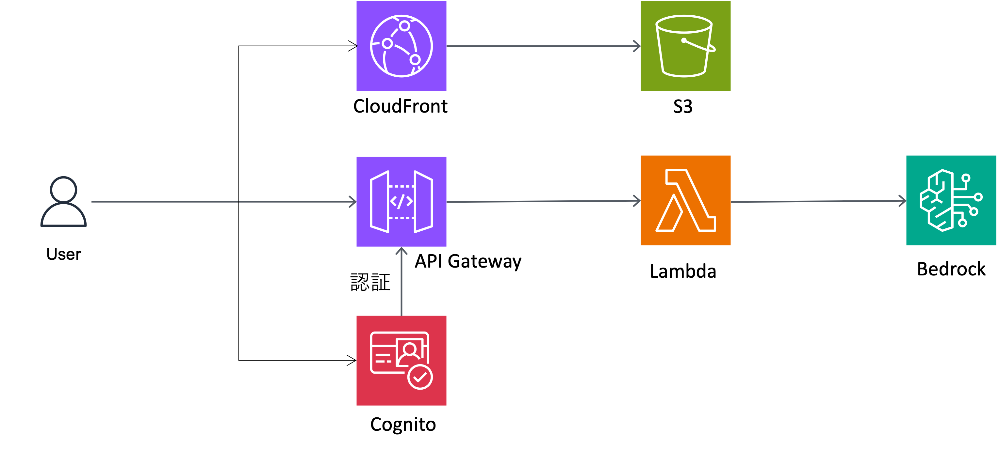

# simplechat：Bedrock を使うチャットアプリ（第7回）

Amazon Bedrock の LLM と会話するチャットアプリです。Amazon Cognito でログインした利用者だけが使えます。
AWS のリソースは、Terraform でコードとして管理します。

**演習と宿題の手順は [lectures/07/problem.md](../lectures/07/problem.md) を見てください。** このファイルは、アプリの構成・コマンドの一覧・詳しいトラブルシューティングをまとめたものです。

## 構成



| 役割 | AWS のサービス | Terraform のファイル |
|---|---|---|
| 画面の配信（CDN） | Amazon CloudFront | `terraform/frontend_hosting.tf` |
| 画面ファイルの保存 | Amazon S3 | `terraform/frontend_hosting.tf`、`terraform/frontend_upload.tf` |
| 利用者の認証 | Amazon Cognito | `terraform/cognito.tf` |
| API の入口 | Amazon API Gateway（REST） | `terraform/api_gateway.tf` |
| アプリの処理 | AWS Lambda（Python） | `terraform/lambda.tf`、`lambda/index.py` |
| 回答の生成 | Amazon Bedrock | `terraform/lambda.tf`（呼び出す権限とモデル ID） |
| ログ | Amazon CloudWatch Logs | `terraform/lambda.tf` |

リクエストの流れは次のとおりです。

1. ブラウザが CloudFront から画面（`index.html`・JS・`config.js`）を受け取る
2. 画面で Cognito にログインし、トークンを受け取る。ログインできるのは、`terraform.tfvars` の `allowed_emails` のアドレスだけ（Terraform がユーザーを作り、招待メールで仮パスワードを送る。画面からのサインアップはできない）
3. 画面がトークンを付けて API Gateway の `POST /chat` を呼ぶ。API Gateway がトークンを確かめる
4. Lambda（`lambda/index.py`）が Bedrock のモデルを呼び出し、回答を返す

`config.js` には、API の URL と Cognito の ID が入ります。Terraform がデプロイのときに作って S3 に置きます。

## ファイルの構成

```text
simplechat/
├── architecture.png        # 構成図
├── frontend/               # 画面（React・Amplify UI。Vite でビルド）。package-lock.json で依存パッケージの版を固定
├── lambda/
│   └── index.py            # API の処理（Bedrock を呼び出す）
├── scripts/
│   ├── setup-state-bucket.sh   # state 用の S3 バケットを作り、terraform/backend.hcl を作る
│   └── delete-state-bucket.sh  # state 用の S3 バケットを削除する
└── terraform/
    ├── versions.tf         # Terraform と provider の版、state の保存先（S3）
    ├── providers.tf        # AWS への接続設定・共通のタグ
    ├── variables.tf        # 変更できる設定値（入力変数）
    ├── terraform.tfvars.example  # 設定値の例（terraform.tfvars にコピーして使う）
    ├── backend.hcl.example # state の保存先の例（通常はスクリプトが作る）
    ├── cognito.tf          # 認証
    ├── frontend_hosting.tf # S3 バケット・CloudFront
    ├── frontend_upload.tf  # 画面ファイルと config.js のアップロード
    ├── lambda.tf           # Lambda・実行ロール・ロググループ
    ├── api_gateway.tf      # API Gateway・Cognito での認証・CORS
    ├── outputs.tf          # デプロイ後に表示する値（URL など）
    ├── templates/config.js.tftpl  # config.js のひな形
    └── .terraform.lock.hcl # provider の版の固定（Git で共有する）
```

## 設定値（terraform.tfvars）

| 変数 | 既定値 | 内容 |
|---|---|---|
| `aws_region` | `us-east-1` | デプロイ先のリージョン |
| `allowed_account_ids` | なし（制限しない） | 適用を許す AWS アカウント ID。自分のアカウント ID を書くと、別のアカウントでの実行を止められる |
| `allowed_emails` | なし（必須） | ログインできるユーザーのメールアドレス。ここにないアドレスでは、サインアップもログインもできない。例のまま（`@example.com`）だとエラーになる |
| `project_name` | `simplechat` | リソース名の先頭に付ける名前。同じアカウントに 2 つ目を作るときは変える |
| `model_id` | `us.amazon.nova-lite-v1:0` | Lambda から呼び出す Bedrock のモデル |
| `lambda_timeout_seconds` | `30` | Lambda のタイムアウト（秒） |
| `log_retention_days` | `7` | Lambda のログの保存日数 |

## コマンドの一覧

リポジトリ直下で、AWS にログインしてから実行します（手順の詳細は [problem.md](../lectures/07/problem.md)）。

```bash
# 実行先の確認
aws sts get-caller-identity

# state 用の S3 バケットの作成（初回・Codespace を作り直したとき）
./simplechat/scripts/setup-state-bucket.sh

# 画面のビルド
(cd simplechat/frontend && npm ci && npm run build)

# デプロイ
cd simplechat/terraform
cp terraform.tfvars.example terraform.tfvars   # 初回のみ。allowed_account_ids と allowed_emails を書く
terraform init -backend-config=backend.hcl
terraform fmt -check
terraform validate
terraform plan -out=day7.tfplan
terraform apply day7.tfplan
terraform output

# 片付け
terraform plan -destroy
terraform destroy
cd ../..
./simplechat/scripts/delete-state-bucket.sh
```

## Terraform の state について

- state は、`setup-state-bucket.sh` が作る S3 バケット（`simplechat-tfstate-<アカウントID>-<リージョン>`）の `simplechat/terraform.tfstate` に保存されます。Codespace を削除しても消えません
- バケットは、一般公開の禁止・バージョニング・暗号化・HTTPS 以外のアクセスの拒否を設定しています。state を誤って壊したときは、バージョニングで前の版に戻せます
- **state を削除・編集しないでください。** 作ったリソースを Terraform で管理・削除できなくなります
- state と plan のファイル（`*.tfplan`）には、リソースの ID や設定値が平文で含まれます。Git には入れません（`.gitignore` で除外しています）
- terraform コマンドの実行中は、S3 にロックのファイル（`terraform.tfstate.tflock`）ができ、同時に別の操作をすると止まります

## トラブルシューティング

### 失敗した場所から原因を切り分ける

| 症状 | まず調べるところ |
|---|---|
| URL が開かない | `terraform output cloudfront_url` と照合する |
| 401 / 403 | ログインしているか、Cognito のトークンが送られているか |
| 400 | 送ったリクエストの形（`message` は 4000 文字まで。応答の `error` に理由が出る） |
| 500 | Lambda のログの `Error:` の行（Bedrock の権限・モデル ID・リクエストの形式）。画面には詳しい理由を返さない |
| timeout | Lambda のタイムアウト、接続先の応答時間 |

### Lambda のログを見る

```bash
cd simplechat/terraform
aws logs tail "/aws/lambda/$(terraform output -raw chat_lambda_function_name)" --since 10m
aws logs tail "/aws/lambda/$(terraform output -raw chat_lambda_function_name)" --follow   # Ctrl + C で終了
```

### API Gateway でテストする

1. AWS マネジメントコンソールで **API Gateway → API → simplechat-api** を開きます
2. リソース `/chat` の `POST` を選び、**テスト** タブを開きます（コンソールからのテストでは、認証を省略できます）
3. 次のように入力して **テスト** を押します

ヘッダー

```text
Content-Type: application/json
```

リクエスト本文

```json
{
  "message": "Tell me about AI and Machine learning",
  "conversationHistory": []
}
```

### Lambda でテストする

1. AWS マネジメントコンソールで **Lambda → 関数 → simplechat-chat** を開きます
2. **テスト** タブで、次のイベント JSON を入力してテストします

```json
{
  "body": "{\"message\":\"What is Momotaro story?\",\"conversationHistory\":[]}",
  "resource": "/chat",
  "path": "/chat",
  "httpMethod": "POST",
  "headers": {
    "Content-Type": "application/json"
  }
}
```

コマンドで実行する場合は、`simplechat/terraform` で次のようにします。

```bash
aws lambda invoke \
  --function-name "$(terraform output -raw chat_lambda_function_name)" \
  --cli-binary-format raw-in-base64-out \
  --payload '{"body":"{\"message\":\"What is Momotaro story?\",\"conversationHistory\":[]}"}' \
  response.json && cat response.json
```

### 認証のエラー

- Cognito のコンソールで、ユーザープール（`simplechat-user-pool`）の設定と、ユーザーの状態を確かめます
- 招待メール（件名 `simplechat: temporary password`）が届かないときは、迷惑メールのフォルダを確かめます。Cognito の既定のメール送信には、1 日あたりの送信数の上限があります
- 仮パスワードの期限は 7 日です。期限が切れたときは、`simplechat/terraform` で次のコマンドを実行して、招待メールを送り直します

```bash
aws cognito-idp admin-create-user --user-pool-id "$(terraform output -raw user_pool_id)" \
  --username <メールアドレス> --message-action RESEND
```

### state のロックが残った

terraform コマンドを途中で強制終了すると、ロックが残ることがあります。ほかに実行中の terraform がないことを確かめてから、エラーに表示された ID で解除します。

```bash
terraform force-unlock <ID>
```
